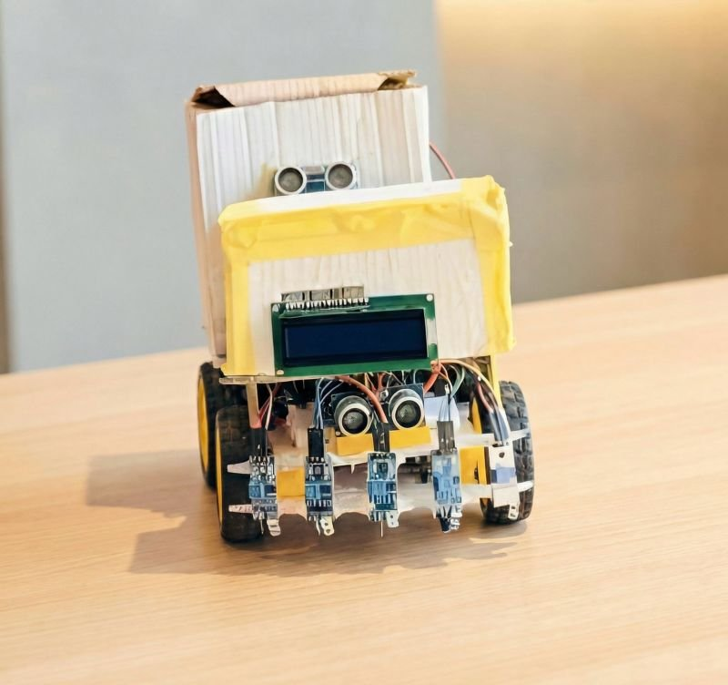
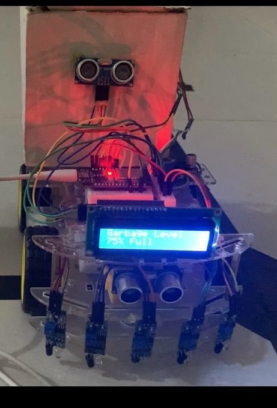
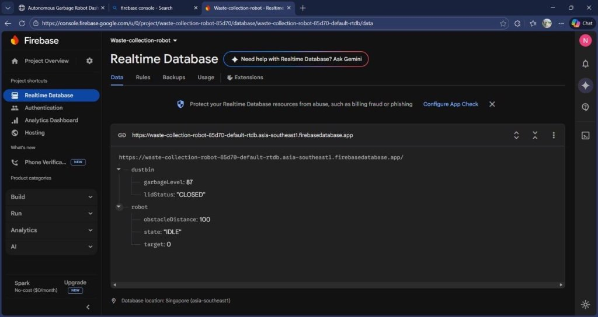
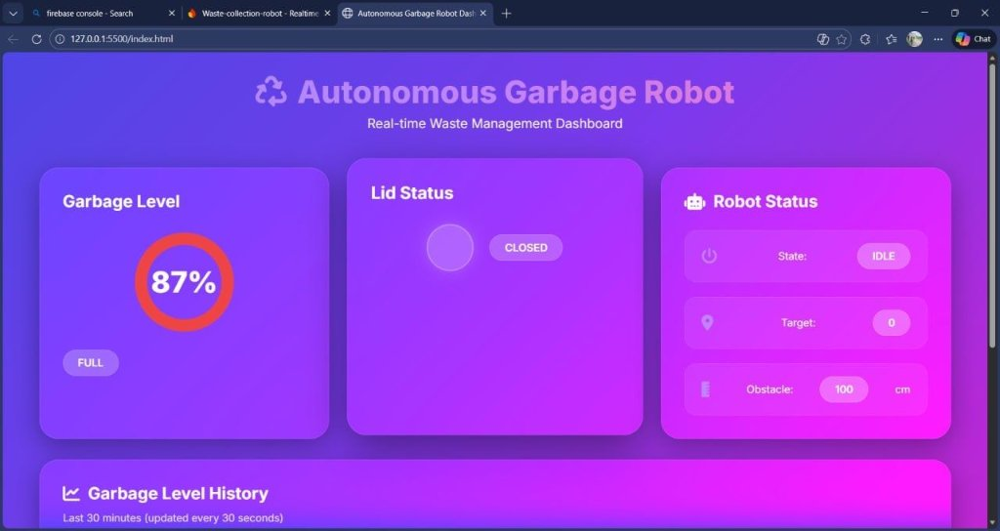

# 🤖 Autonomous Garbage Collecting & Smart Monitoring Robot ♻️

An IoT-powered autonomous waste management robotic vehicle designed for smart campus environments, commercial facilities, and indoor automated collection. This system integrates autonomous multi-sensor line navigation, intelligent obstacle avoidance, touchless gesture-controlled smart lid actuation, real-time ultrasonic bin fill monitoring, and cloud telemetry via Firebase Realtime Database with an interactive web dashboard.

---

## 📸 Project Showcase

<div align="center">
  <table border="0">
    <tr>
      <td width="50%" align="center">
        <b>Chassis & Hardware Configuration</b><br><br>
        
      </td>
      <td width="50%" align="center">
        <b>Live Operation & LCD Bin Monitoring</b><br><br>
        
      </td>
    </tr>
    <tr>
      <td width="50%" align="center">
        <b>Firebase Realtime Database Cloud Sync</b><br><br>
        
      </td>
      <td width="50%" align="center">
        <b>Real-Time Web Analytics Dashboard</b><br><br>
        
      </td>
    </tr>
  </table>
</div>

---

## 🌟 Key Features

- **Autonomous Waypoint Navigation**: 5-channel infrared sensor array implements high-precision differential tracking across junctions and predetermined waste collection waypoints.
- **Dynamic Obstacle Avoidance**: Forward-facing ultrasonic sensor (HC-SR04) continuously scans the travel path to prevent collisions with obstacles and pedestrians.
- **Hands-Free Gesture-Controlled Lid**: Proximity ultrasonic detection triggers an automated servo motor (SG90) to open and close the container lid without physical contact, ensuring hygiene.
- **Continuous Level Measurement**: Internal ultrasonic sensor calculates volume fill percentage and alerts when capacity exceeds critical thresholds.
- **Local & Remote Feedback**: High-contrast 16x2 I2C LCD screen displays immediate real-time statistics locally on the robot.
- **IoT Cloud Connectivity**: NodeMCU / ESP32 securely syncs collection state, obstacle alerts, and bin level to Google Firebase Realtime Database.
- **Centralized Web Dashboard**: Live web-based monitoring console built with glassmorphism UI, circular fill gauges, lid state lights, and 30-minute level history graphs.
- **Wireless Bluetooth Control**: Supports manual dispatch, halt overrides, and destination commands via onboard Bluetooth serial communication.

---

## 🗂️ System Architecture

```
                       +---------------------------------------+
                       |   Autonomous Mobile Robot Chassis     |
                       |  - 5-Channel IR Line Tracking Array   |
                       |  - Front HC-SR04 Obstacle Sensor      |
                       |  - L298N Motor Driver + DC Motors     |
                       |  - Bluetooth Serial Remote Control    |
                       +-------------------+-------------------+
                                           |
                                           v
                       +---------------------------------------+
                       |      Smart Dustbin IoT Module         |
                       |  - Hand Presence Sensor (Ultrasonic)  |
                       |  - Fill Level Sensor (Ultrasonic)     |
                       |  - SG90 Micro Servo (Lid Actuator)    |
                       |  - 16x2 I2C LCD Local Display         |
                       |  - NodeMCU (ESP8266) / ESP32 Wi-Fi    |
                       +-------------------+-------------------+
                                           |
                                 Wi-Fi Telemetry (JSON)
                                           |
                                           v
                       +---------------------------------------+
                       |   Google Firebase Realtime Database   |
                       |  - /dustbin (garbageLevel, lidStatus) |
                       |  - /robot (state, target, obstacle)   |
                       +-------------------+-------------------+
                                           |
                                 WebSockets / REST
                                           |
                                           v
                       +---------------------------------------+
                       |  Interactive Web Monitoring Dashboard  |
                       |  - Live Fill Ring Gauge (0-100%)      |
                       |  - Touchless Lid Status Indicator     |
                       |  - Robot Operational State Monitor    |
                       |  - Level History Trend Analysis Chart |
                       +---------------------------------------+
```

---

## 🛠️ Hardware Components

| Component | Quantity | Purpose |
|---|:---:|---|
| **Microcontroller (NodeMCU ESP8266 / ESP32)** | 1 | IoT cloud publishing, Wi-Fi connectivity, servo handling |
| **Microcontroller (Arduino Nano)** | 1 | Embedded motor logic, sensor polling, real-time control |
| **5-Channel IR Sensor Array** | 1 | Multi-point line tracking and junction recognition |
| **HC-SR04 Ultrasonic Sensors** | 3 | Obstacle detection (front), hand gesture detection, bin fill measurement |
| **SG90 Micro Servo Motor** | 1 | Touchless lid actuation mechanism |
| **L298N Dual H-Bridge Motor Driver** | 1 | Reversible DC motor speed and direction control |
| **BO Gear Motors with Wheels** | 2 | Differential drive mobility |
| **16x2 I2C Character LCD** | 1 | On-board visual readout for users and technicians |
| **Rechargeable Battery Pack (7.4V - 11.1V)** | 1 | Main chassis and motor power source |
| **LM2596 DC-DC Buck Converter / 5V BEC** | 1 | Regulated clean power for microcontrollers and servo |

---

## ⚡ Circuit Diagram & Pin Allocation

The detailed schematic diagram is available in [`circuit_diagram/circuit_image.png`](circuit_diagram/circuit_image.png). For step-by-step wiring instructions, refer to the complete [Pinout & Wiring Guide](circuit_diagram/pinout_guide.md).

```
   [Battery 7.4V/11.1V] ---> [LM2596 5V Regulator] ---> Microcontrollers & Sensors
             |
             +-------------> [L298N VMS Motor Power]
```

### Pin Summary:
- **Chassis Drive**: `ENA -> GPIO 25`, `ENB -> GPIO 26` (PWM), `IN1-IN4 -> GPIO 27, 14, 12, 13`
- **IR Tracking Array**: `L2 -> 32`, `L1 -> 33`, `C -> 35`, `R1 -> 34`, `R2 -> 39`
- **Obstacle Sensor**: `Trig -> GPIO 5`, `Echo -> GPIO 18`
- **Smart Bin Lid Servo**: `Signal -> GPIO 13` (PWM angle control)
- **Hand Presence Sensor**: `Trig -> GPIO 25`, `Echo -> GPIO 26`
- **Garbage Level Sensor**: `Trig -> GPIO 27`, `Echo -> GPIO 14`
- **16x2 LCD**: `SDA -> GPIO 21`, `SCL -> GPIO 22` (I2C bus address: `0x27`)

---

## ☁️ Firebase Cloud Data Schema

Real-time values are synchronized to the following JSON structure:

```json
{
  "dustbin": {
    "garbageLevel": 87,
    "lidStatus": "CLOSED"
  },
  "robot": {
    "obstacleDistance": 100,
    "state": "IDLE",
    "target": 0
  }
}
```

---

## 💻 Web Dashboard

The project includes a standalone web dashboard located in the [`web-dashboard/`](web-dashboard/) folder:

- **Circular Progress Meter**: Dynamically transitions between `EMPTY` (green), `MODERATE` (yellow), and `FULL` (glowing crimson).
- **Lid Status Beacon**: Real-time glow indicator reflecting when the contactless bin lid opens or closes.
- **Chassis Metrics**: Monitors obstacle distance, operating state (`IDLE`, `LINE_FOLLOW`, `WAIT_AT_TARGET`), and target station.
- **Trend Chart**: Visualizes bin fill rate history over 30-minute operational intervals.

### Launching the Dashboard:
1. Open [`web-dashboard/index.html`](web-dashboard/index.html) in any modern web browser or serve via VS Code Live Server.
2. The dashboard automatically connects to the Firebase endpoint, or operates in built-in demonstration mode if disconnected.

---

## 🚀 Setup & Installation

### 1. Firmware Upload
1. Open the [Arduino IDE](https://www.arduino.cc/en/software).
2. Install the following libraries via the Library Manager:
   - `LiquidCrystal_I2C`
   - `ESP32Servo` (or `Servo` for Arduino Nano)
   - `Firebase_ESP_Client` (by Mobizt)
   - `BluetoothSerial`
3. Open [`Line_Following/linefollowing_code.ino`](Line_Following/linefollowing_code.ino), select your board and COM port, and upload.
4. Open [`Bin/bin_code.ino`](Bin/bin_code.ino), enter your local Wi-Fi SSID, password, and Firebase credentials, then upload.

### 2. Autonomous Navigation Operation
1. Place the robot on a line track containing junction cross-lines.
2. Pair your mobile device with the robot's Bluetooth broadcast (default name: `MYrobot`).
3. Send `'1'`, `'2'`, or `'3'` to dispatch the robot to station 1, 2, or 3.
4. Send `'X'` at any moment for an emergency stop.

---

## 👥 Contributors & Acknowledgements

Developed with dedication to practical robotics, environmental cleanliness, and smart automation.
- **Repository Author**: [@Niki824](https://github.com/Niki824)
- **Project Topic**: Autonomous Garbage Collecting & Smart Monitoring Robot
